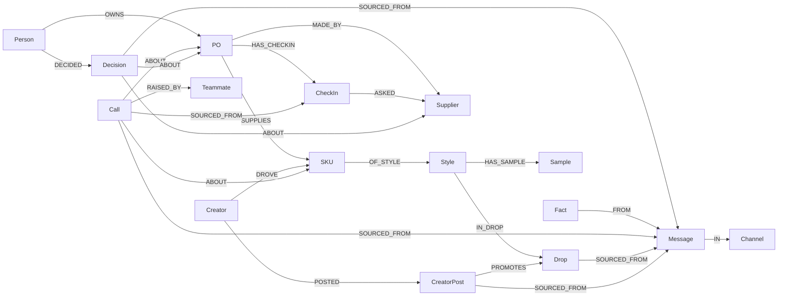

# Weft

Weft is one live plan for a D2C brand's products, from planning to restock: each drop is a FalkorDB graph, and AI teammates chase the updates and show what every change breaks.

A D2C product is planned, made, sold and restocked, and each stage lives in a different tool: a spreadsheet for the plan, WhatsApp groups for the factory, Shopify for orders, and the founder's memory for reorders. The failures happen at the joins. A supplier's delay sits in a chat while creators promise the launch date. A size sells out on day four and the reorder waits, because nobody compared sell-through with lead time. The restock lands and the stock count is still wrong. Weft puts every stage on one graph, so a change anywhere shows what it breaks everywhere.

## Demo

- **Live:** https://weft.kshitijbhardwaj.space (landing page → *Open the live demo*)
- **Demo login** (also shown on the login page): `founder@blackdrop.in` / `blackdrop`. Signing in starts a guided tour of the major features, each step naming the FalkorDB feature behind it. *Reset demo data* in the tour reseeds the graphs.
- **Video (3½ min):** https://weft.kshitijbhardwaj.space/weft-demo.mp4 (also [docs/demo/weft-demo.mp4](docs/demo/weft-demo.mp4)): the problem and solution as infographics, a real walkthrough, and how we use FalkorDB
- **Blog post:** [docs/blog/weft-falkordb.md](docs/blog/weft-falkordb.md)

### Deployment

The public URL is a Cloudflare Worker ([deploy/cloudflare](deploy/cloudflare)) on a custom domain. It proxies to the Next.js server, which runs with its own FalkorDB instance seeded with the demo data, reached through a Cloudflare Tunnel. The Worker keeps the public URL stable; `ORIGIN` in `wrangler.jsonc` points it at the app server.

## Tracks

Weft is entered in three tracks of the FalkorDB Graph Hacks hackathon.

- **Track 03: Company Brain (primary).** The plan, supplier check-ins, sales and creator posts sit in one connected graph. The teammates answer from it, and *See why* shows the nodes and path behind each answer.
- **Track 02: Agent Memory and Coordination.** The three teammates share one graph as their memory. Calls and decisions are nodes that link back to the messages and check-ins they came from. Scenarios let a change be tested in a private copy before it touches the plan.
- **Track 01: Agents That Act on Connected Data.** Shuttle and Pattern raise calls from multi-hop queries: delay impact, restock drafts, supplier follow-ups. Accepting a call writes the decision into the plan.

## How it works

The plan is the source of truth. The app reads and writes one live graph per drop (`weft`) directly. There are four ways it stays current:

1. **Team in the UI.** *Your call* on Today applies or ignores a call from a teammate. Applying writes the change and a `Decision` node that records who made it.
2. **Supplier check-ins.** Shuttle asks a supplier a structured question before something is due, answered in one tap in the supplier's view (`/supplier/sri`), by email (Resend) or by WhatsApp buttons (Cloud API). A "delayed" answer with a new date raises a delay call and shows its impact.
3. **Chat.** Real-time conversations with suppliers, the team and the AI teammates. Shuttle reads every supplier and team message and proposes plan updates: a forward stage move ("cutting done for PO-017") applies on its own and is recorded as a fact against the message; a date change ("fabric delayed, coming 28th") becomes a call with its impact. Mention `@weft`, `@shuttle` or `@pattern` to ask in place, or open a teammate's own chat. *Ask* (⌘J) is available on every screen.
4. **Calendar and gone quiet.** A check-in with no answer after its due date shows as *gone quiet*. The demo seeds one: the olive lab dip from Ananya Fabrics on PO-019. There is no calendar connection yet.

## Conversations

The sidebar groups conversations three ways:

- **Suppliers.** One chat per supplier (Sri Lakshmi Knits, Kavya Garments, Ananya Fabrics). The supplier sees only their chat, their POs and check-ins (`/supplier/<id>`); the team sees the same chat with a PO panel (`/chat/sup-<id>`). Inbound WhatsApp messages land here.
- **Team.** `#ops` and `#marketing`.
- **AI teammates.** A chat with Weft (chief of staff), Shuttle (production lead) and Pattern (sales analyst). Each answers from the graph with *See why*.

Messages are graph nodes, `(:Message)-[:IN]->(:Channel)`, so teammates can read them and every fact or call links back to the message it came from. New messages reach open clients over Server-Sent Events. Roles are enforced on every decision: only an Owner or Manager can accept a call, approve a PO or apply a scenario (switch who you're acting as at the bottom of the sidebar; sign-in comes next).

## Integrations

Each integration is optional and skips cleanly when its keys are unset (see `web/.env.example`).

- **Shopify** (`src/lib/integrations/shopify.ts`): `POST /api/integrations/shopify/sync` pulls orders, refunds, discount codes and inventory through the Admin GraphQL API and writes sold, returns, on-hand and creator attribution onto the SKU and Creator nodes. `POST /api/integrations/shopify/webhook` verifies the HMAC and applies `orders/create` and `refunds/create` incrementally. The demo uses seeded sales so it runs without a store.
- **Resend** (`src/lib/integrations/email.ts`): PO and check-in emails to the supplier contact, with one-tap links.
- **WhatsApp Cloud API** (`src/lib/integrations/whatsapp.ts`, `/api/integrations/whatsapp/webhook`): check-ins as reply buttons, POs as an approved template, and inbound supplier messages posted into the supplier chat, where Shuttle reads them.
- Suppliers are notified when a call is applied (follow-ups), a restock PO is approved, or a scenario moves a PO to them.

**Act 1, Countdown (18 Nov).** Shuttle has an open check-in on PO-014, the leggings fabric from Sri Lakshmi Knits. Sri Lakshmi says the fabric is delayed. Weft turns that into a delay call: the drop is at risk, and the creator posts from Ria, Dev and Tara that promise 1 Dec are broken. In *Scenarios*, move PO-014 to Kavya Garments. A private copy of the plan is created, and the PO is re-dated from Kavya's 10-day lead time, so it lands before the drop. Compare the two outcomes, then *Apply to plan*. The scenario replaces the plan and a decision is recorded. The move costs 600 units at +₹20 a piece, or ₹12,000.

**Act 2, Live day 9 (10 Dec).** 62% of the 2,100 planned units have sold. The sell-through heatmap shows Black leggings M sold out on day 4. Pattern has drafted a restock from Kavya Garments, who made this batch after the scenario (10-day lead time), and *Your call* applies it as PO-020. The open PO covers that SKU, so it leaves *Restock now*. *Mark received* on the PO adds its quantity to stock. The creator panel ranks Ria (RIA15), Dev (DEV10) and Tara (TARA10) by orders, with their repeat rates. Open *Ask* and ask Pattern a question to see the queries behind the answer.

## Graph data model



Every node carries an `id`.

| Node | Properties |
|---|---|
| `Drop` | name, date, phase, today, orders |
| `Style` | name, price (INR), fabric |
| `SKU` | code, line, colour, size, planned, sold, onHand, returns, returnReason |
| `Supplier` | name, type, city, leadDays, contact |
| `PO` | qty, unitPrice, eta, stage, status |
| `CheckIn` | question, due, status (open, answered, quiet, chased), answer |
| `Sample` | kind, status, date, note |
| `Creator` | handle, code, orders, repeatRate |
| `CreatorPost` | date, says |
| `Person` | name, role |
| `Teammate` | name, role |
| `Message` | author, channel, text, at |
| `Call` | kind (delay, restock, date, followup), title, summary, status, at, newEta |
| `Decision` | text, at, by |

Dates are ISO strings. Revenue is `SKU.sold × Style.price`.

The app keeps four graphs in one FalkorDB instance:

- `weft`: the Countdown plan, the source of truth.
- `weft_live`: the Live (day 9) snapshot, used when the demo clock is set to Live.
- `weft_meta`: workspace settings (the active phase) and scenario records (`Setting`, `Scenario` nodes).
- `weft_scn*`: scenario copies. Each one is created with `GRAPH.COPY` from the active plan and deleted when applied or discarded.

## Cypher queries and graph algorithms the product depends on

### Delay impact: what a slip on one PO breaks

Multi-hop traversal from a PO through its SKUs and style to its drop, then back to the creator posts that promise the drop date. It powers the impact text on every delay call (`impactOf` in `web/src/lib/plan.ts`).

```cypher
MATCH (po:PO {id:$po})-[:MADE_BY]->(sup:Supplier), (owner:Person)-[:OWNS]->(po),
      (po)-[:SUPPLIES]->(k:SKU)-[:OF_STYLE]->(s:Style)-[:IN_DROP]->(d:Drop)
OPTIONAL MATCH (cr:Creator)-[:POSTED]->(p:CreatorPost)-[:PROMOTES]->(d)
RETURN po.id AS po, sup.name AS supplier, collect(DISTINCT k.code) AS skus, s.name AS style,
       d.name AS drop, d.date AS dropDate, owner.name AS owner,
       collect(DISTINCT {handle: cr.handle, date: p.date}) AS posts
```

### Sell-through heatmap and totals

The totals are aggregated in Cypher. The heatmap query returns one row per SKU, and the percentage per cell and the sold-out flag are computed in `heatmap()` (`web/src/lib/plan.ts`).

```cypher
MATCH (k:SKU)-[:OF_STYLE]->(s:Style)
RETURN k.line AS line, s.name AS style, k.colour AS colour, k.size AS size, k.sold AS sold, k.planned AS planned
ORDER BY line, size DESC
```

```cypher
MATCH (k:SKU)-[:OF_STYLE]->(s:Style)
RETURN sum(k.sold) AS sold, sum(k.planned) AS planned, sum(k.sold * s.price) AS revenue, sum(k.returns) AS returns
```

### Restock suggestions

The query pulls each SKU that has sold, with its supplier and lead time. The formula runs in `restocks()` (`web/src/lib/plan.ts`).

```cypher
MATCH (k:SKU)-[:OF_STYLE]->(s:Style), (po:PO)-[:SUPPLIES]->(k), (po)-[:MADE_BY]->(sup:Supplier)
WHERE k.sold > 0
RETURN k.id AS id, s.name AS style, k.colour AS colour, k.size AS size, k.sold AS sold, k.onHand AS onHand,
       sup.name AS supplier, sup.leadDays AS leadDays
```

The formula, as implemented:

```
daysLive = max(1, days from drop date to today)
rate     = sold / daysLive
qty      = ceil to 10 of max(0, rate × leadDays − onHand)
shown    = qty > 0 and days of stock left (onHand / rate) < 7, sorted by days left
```

Today shows the top 3. Applying a restock call looks up its SKU among the top 10.

### Supplier risk: PageRank over supply edges

PageRank over the `MADE_BY` edges ranks the suppliers the drop leans on most, which surfaces single points of failure in the Supply panel on Today (`supplierRisk()` in `web/src/lib/plan.ts`). If the procedure fails or returns nothing, the code falls back to this degree count:

```cypher
CALL algo.pageRank(null, 'MADE_BY') YIELD node, score
WITH node, score WHERE node:Supplier
OPTIONAL MATCH (node)<-[:MADE_BY]-(:PO)-[:SUPPLIES]->(k:SKU)
RETURN node.name AS name, score, count(k) AS skus ORDER BY score DESC
```

```cypher
MATCH (sup:Supplier)<-[:MADE_BY]-(:PO)-[:SUPPLIES]->(k:SKU)
RETURN sup.name AS name, count(k) AS skus, toFloat(count(k)) / 15.0 AS score ORDER BY skus DESC
```

### Scenarios: copy, change, compare, apply

A scenario is a full copy of the active plan, made with the falkordb client's `graph.copy()` (which issues `GRAPH.COPY`). `copyGraph()` in `web/src/lib/graph.ts`:

```ts
export async function copyGraph(from: string, to: string) {
  const d = await db();
  if ((await d.list()).includes(to)) await d.selectGraph(to).delete();
  await d.selectGraph(from).copy(to);
}
```

The change is made only inside the copy. The PO's supplier edge is swapped, the PO is re-dated from the new supplier's lead time, and the open call is resolved (`createScenario()` in `web/src/lib/scenarios.ts`):

```cypher
MATCH (po:PO {id:$po})-[r:MADE_BY]->(:Supplier), (to:Supplier {id:$to})
DELETE r
CREATE (po)-[:MADE_BY]->(to)
SET po.eta = $eta, po.unitPrice = po.unitPrice + 20, po.status = 'accepted', po.stage = 'Fabric'
WITH po OPTIONAL MATCH (c:Call {status:'open'})-[:ABOUT]->(po) SET c.status = 'resolved'
```

The comparison asks the same question of two graphs: reality (the plan, with any pending delay applied) and the scenario copy. `sideOf()` runs this query against each graph:

```cypher
MATCH (p:PO {id:$po})-[:MADE_BY]->(sup:Supplier), (p)-[:SUPPLIES]->(:SKU)-[:OF_STYLE]->(:Style)-[:IN_DROP]->(d:Drop)
OPTIONAL MATCH (c:Call {status:'open', kind:'delay'})-[:ABOUT]->(p)
OPTIONAL MATCH (:Creator)-[:POSTED]->(cp:CreatorPost)-[:PROMOTES]->(d)
RETURN sup.name AS supplier, p.eta AS eta, c.newEta AS pending, p.qty * p.unitPrice AS cost,
       d.date AS dropDate, count(DISTINCT cp) AS posts
```

Apply to plan copies the scenario graph over the plan (`copyGraph(s.graph, s.base)`), then records the decision in the plan and deletes the scenario copy (`applyScenario()` in `web/src/lib/scenarios.ts`):

```cypher
MATCH (k:Person {id:'kshitij'}), (po:PO {id:$po})-[:MADE_BY]->(sup:Supplier)
CREATE (k)-[:DECIDED]->(d:Decision {id:'d-' + $id, text:'Moved ' + $po + ' to ' + sup.name + ' (scenario ' + $id + ')', at:$at, by:'Kshitij'})-[:ABOUT]->(po),
       (d)-[:ABOUT]->(sup)
```

### See why: the path behind an answer

For each pair of nodes an answer relied on, the Brand map finds the shortest path of up to five hops and highlights it. The first node is paired with each of the others (`web/src/app/map/page.tsx`). The query orders the matches by path length and takes the first one; it is a bounded variable-length match, not `shortestPath()`.

```cypher
MATCH (a {id:$a}), (b {id:$b})
MATCH p = (a)-[*1..5]-(b)
WITH p, length(p) AS len ORDER BY len LIMIT 1
RETURN [n IN nodes(p) | n.id] AS ids
```

### Indexes

The seed script creates these indexes (`web/scripts/seed.mjs`):

```ts
for (const [label, ...props] of [["SKU", "code", "colour", "line"], ["Style", "name"], ["Supplier", "name"], ["PO", "id"], ["Creator", "handle"]]) {
  await g.createNodeFulltextIndex(label, ...props);
}
for (const label of ["SKU", "Style", "Supplier", "PO", "Drop", "Creator", "Message", "Call", "Decision", "CheckIn"]) {
  await g.createNodeRangeIndex(label, "id");
}
```

The full-text indexes power search on the Brand map (`/map?search=olive`), which highlights every matching node:

```cypher
CALL db.idx.fulltext.queryNodes($label, $term) YIELD node RETURN node.id AS id
```

The range indexes back the `{id: ...}` lookups throughout the queries above.

### Teammates: Claude over a read-only Cypher tool

Weft, Shuttle and Pattern are one Claude model (`claude-opus-5-5`, low effort) in a manual tool loop of up to eight turns (`web/src/app/api/ask/route.ts`). The model's only tool is `run_cypher`, which takes a `query` and a one-line `why`. Each query runs through `GRAPH.RO_QUERY`, so the teammates cannot write to the graph. The system prompt includes the graph schema, and the model cites the node ids it relied on in square brackets. Every query the model runs is recorded and shown to the user under *See why*, with its row count or error.

## FalkorDB features used

| Feature | Where it is used |
|---|---|
| Multi-hop Cypher | Delay impact: PO → SKU → Style → Drop ← CreatorPost ← Creator (`impactOf`) |
| `GRAPH.COPY` (falkordb `graph.copy()`) | Scenarios, the Live snapshot, Apply to plan |
| Multiple graphs | `weft`, `weft_live`, `weft_meta`, and `weft_scn*` scenario copies |
| Bounded path query | *See why* paths on the Brand map |
| Graph algorithm (`algo.pageRank`) | Supplier risk over `MADE_BY` edges, with a degree-count fallback |
| Aggregations | Totals (sold, planned, revenue, returns), sell-through heatmap, restock inputs |
| Full-text index | Brand map search over SKU, Style, Supplier, PO and Creator (`db.idx.fulltext.queryNodes`) |
| Range index | `id` on ten labels, backing the `{id: ...}` lookups |
| Read-only queries | `GRAPH.RO_QUERY` for reads, including every Ask tool call |
| Agent tool over Cypher | Ask: the teammates query the graph with `run_cypher`; every query is shown under *See why* |

## Run it locally

Prerequisites: Node 20 or later, pnpm, and Docker (or Colima on macOS).

```bash
docker compose up -d                 # FalkorDB on port 6380, FalkorDB Browser on port 3001
cd web && pnpm install
cp .env.example .env.local           # then set ANTHROPIC_API_KEY in web/.env.local
pnpm seed                            # builds the demo graphs
pnpm dev                             # open http://localhost:3000
```

Notes:

- `pnpm seed` rebuilds `weft` and `weft_live` and resets the demo to Countdown. Run it again at any time to reset the demo.
- The demo clock is the **Countdown · 18 Nov** / **Live · 10 Dec** toggle at the top of Today.
- *Ask* opens with ⌘J. It needs `ANTHROPIC_API_KEY`. The other pages work without it.
- The supplier view for Sri Lakshmi Knits is at `/supplier/sri`; the team's view of the same chat is at `/chat/sup-sri`.
- Try typing as Murugan in the supplier view: "Cutting done for PO-017" or "Fabric delayed, coming 28th".
- The FalkorDB Browser, to inspect the graphs directly, is at http://localhost:3001.

## Project structure

```
web/
  scripts/seed.mjs          seeds the demo graphs and indexes
  src/app/
    page.tsx                Today (/)
    production/             Production: every PO and its check-ins
    supplier/[id]/          supplier view: POs, check-ins and chat (/supplier/sri)
    chat/[channel]/         conversations: suppliers, team, AI teammates
    drop/                   drop view
    scenarios/              scenarios: create, compare, apply
    map/                    Brand map with See why paths
    api/
      ask/                  Ask: teammate tool loop over run_cypher
      chat/[channel]/       post a message; stream/ pushes new messages (SSE)
      integrations/         shopify/sync, shopify/webhook, whatsapp/webhook
      calls/[id]/           apply or ignore a call
      checkins/[id]/        answer a check-in (yes or delayed)
      scenarios/            create, apply, discard a scenario
      phase/                switch the demo clock
  src/lib/
    graph.ts                FalkorDB client, read-only queries, GRAPH.COPY
    plan.ts                 plan queries: heatmap, totals, restocks, PageRank, impact
    scenarios.ts            scenario create, compare, apply, discard
    chat.ts                 channels, messages, real-time bus
    agent.ts                teammates: Claude over read-only Cypher
    proposals.ts            teammates propose plan updates from chat
    checkins.ts             answer check-ins, raise delay calls
    roles.ts                Owner / Manager / Member
    integrations/           shopify, email (Resend), whatsapp, notify
  src/components/           AskPanel, BrandMap, CallCard, CheckInCard, ScenarioActions, Sidebar, TopBar
inter/
  product.md                product definition: problem, kernel, glossary (written before building)
  m1-drop-loop/spec.md      milestone spec: stack, graph model, FalkorDB features, rules
docker-compose.yml          FalkorDB and its browser
```

## Roadmap

- Sign-in with email magic links (Resend), replacing the acting-as switcher.
- Shopify: webhook de-duplication, and an end-to-end run against a live store.
- Create drops, styles, SKUs and POs in the app (planning is read-only today).
- Scenarios that simulate sales, stock and cash, not only dates and suppliers.
- Vector index for semantic search over messages, alongside the full-text index.
- More teammates on the same graph: brand guardian, finance, customer support.

## Built with AI assistance

Weft was built with Claude Code (Claude Opus 5.5) as a pair programmer. The team designed the product, the graph model and the queries, and reviewed all of the code.
