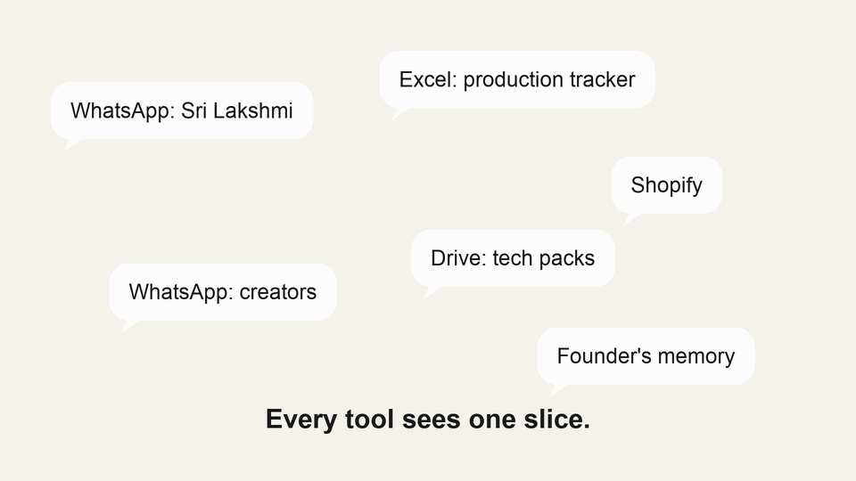
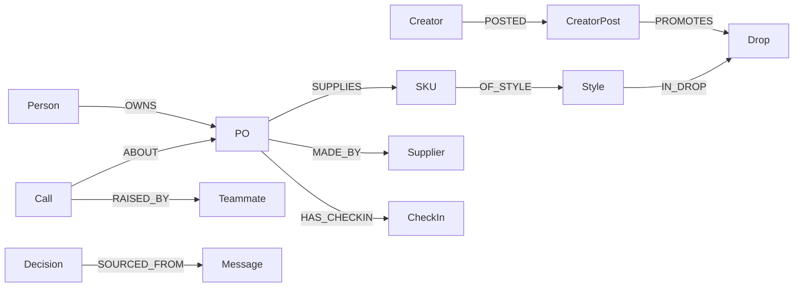
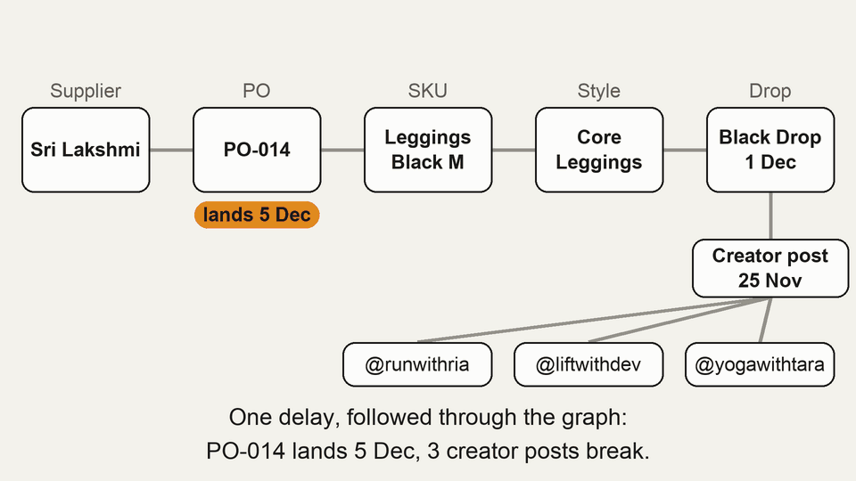
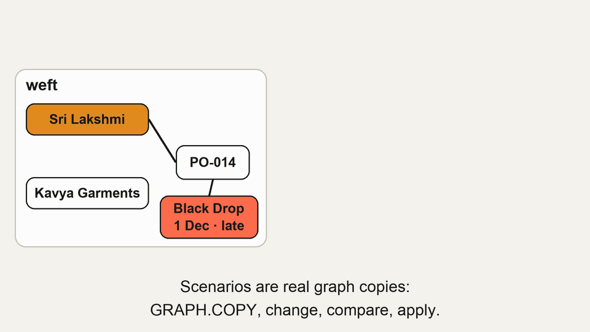

# Weft: one live plan per drop, on a FalkorDB graph

Thirteen days before our Black Drop goes live, a message arrives from the factory in a WhatsApp group: the fabric for the leggings is late. It sits between a dozen other messages. Three creators have already scheduled posts that say the drop goes live on 1 December. Nothing we use connects the two.



Weft is what we built for FalkorDB's Graph Hacks: Context for AI Agents hackathon. It keeps one live plan for each drop, stored as a graph, and three AI teammates work on that plan. This post covers why we chose a graph, how the model is laid out, and what the demo does with it.

## The problem

Small D2C brands miss launches and money for things nobody noticed in time. A supplier goes quiet, a delay is buried in a chat, a size sells out while the reorder never goes out.

Every tool sees one slice. Shopify sees orders, WhatsApp holds the supplier talk, and a spreadsheet holds the production plan. Problems that cross from making to selling stay invisible until a customer or a creator notices.

## Why this is a graph problem

The questions that matter are about connections, not records. "Which creator posts break if PO-014 is late?" is not a lookup on the PO. It is a walk from the PO through its SKUs, their style and drop, and back in through every creator post that promotes that drop.

A relational schema can answer that with joins written by hand for each question. We wanted the walk to be the query itself, and we wanted the same walk to run inside every step an agent takes. That is the case for a graph.

## Why FalkorDB

Each reason below maps to something the app does.

- **Multi-hop traversal.** The delay query goes five hops, from a PO to a creator. We needed that fast enough to run inside every agent step, not as a nightly job.
- **Many graphs in one instance.** The Countdown plan is the graph `weft`. The day-9 snapshot is `weft_live`. Each scenario is its own graph, and `weft_meta` holds the current phase.
- **GRAPH.COPY.** A scenario is a full copy of the plan. We change the copy, compare it with reality, and throw it away or apply it.
- **Built-in algorithms.** PageRank runs over the supply edges through a single procedure call.
- **openCypher.** The app, the agent tool and the seed script use one query language.

The web app is Next.js 15 with server components that read the graph directly, and route handlers for actions. The seed script loads the 15-SKU Black Drop into FalkorDB and creates the Live snapshot in the same run.

## The model



Every node carries an `id`, and every decision points back to where it came from. A `Decision` is `SOURCED_FROM` a `Message` or a `CheckIn`, so the founder can always ask where a change was agreed.

The design rule is simple: **the plan is the source of truth, and chat is one input.** If nobody types, nothing should silently go stale. The plan is kept current four ways:

1. The team edits the plan in the UI.
2. Supplier check-ins. Shuttle asks a supplier a structured question before something is due, and the answer is one tap.
3. Chat. Messages are nodes, and decisions link back to them. Turning chat into proposed updates is next.
4. The calendar. A due date that passes with no confirmation becomes a check-in that has gone quiet.

The demo builds the first two in full. It seeds a quiet check-in for the olive lab dip on PO-019, so the graph already holds an example of the fourth. Real calendar reading is not built yet.

## Feature walkthrough

### 1. Delay impact: follow the slip through the graph

When a PO slips, the question is what it breaks. This query starts at the PO and walks to its SKUs, their style and drop, then back in through every creator post that promotes that drop.

```cypher
MATCH (po:PO {id:$po})-[:MADE_BY]->(sup:Supplier), (owner:Person)-[:OWNS]->(po),
      (po)-[:SUPPLIES]->(k:SKU)-[:OF_STYLE]->(s:Style)-[:IN_DROP]->(d:Drop)
OPTIONAL MATCH (cr:Creator)-[:POSTED]->(p:CreatorPost)-[:PROMOTES]->(d)
RETURN po.id AS po, sup.name AS supplier, collect(DISTINCT k.code) AS skus, s.name AS style,
       d.name AS drop, d.date AS dropDate, owner.name AS owner,
       collect(DISTINCT {handle: cr.handle, date: p.date}) AS posts
```

A drop is at risk when any PO supplying it lands after the drop date, and the creator posts promoting it are then broken. The result feeds the "Your call" card with its impact: the SKUs at risk, the creators who promised the date, and the person who owns the PO.



### 2. Scenarios: copy, change, compare, apply

A scenario is a private copy of the plan. We create it with GRAPH.COPY, then make the change inside the copy only. In the demo, the change is moving PO-014 from Sri Lakshmi Knits to Kavya Garments.

```cypher
MATCH (po:PO {id:$po})-[r:MADE_BY]->(:Supplier), (to:Supplier {id:$to})
DELETE r
CREATE (po)-[:MADE_BY]->(to)
SET po.eta = $eta, po.unitPrice = po.unitPrice + 20, po.status = 'accepted', po.stage = 'Fabric'
WITH po OPTIONAL MATCH (c:Call {status:'open'})-[:ABOUT]->(po) SET c.status = 'resolved'
```

The new ETA is today plus the new supplier's lead time, the unit price goes up by 20 for the demo, and any open call on that PO is marked resolved. All of it happens only inside the copy.

Compare asks the same question of both graphs. The reality side includes any pending delay, and the scenario side uses the new supplier:

```cypher
MATCH (p:PO {id:$po})-[:MADE_BY]->(sup:Supplier), (p)-[:SUPPLIES]->(:SKU)-[:OF_STYLE]->(:Style)-[:IN_DROP]->(d:Drop)
OPTIONAL MATCH (c:Call {status:'open', kind:'delay'})-[:ABOUT]->(p)
OPTIONAL MATCH (:Creator)-[:POSTED]->(cp:CreatorPost)-[:PROMOTES]->(d)
RETURN sup.name AS supplier, p.eta AS eta, c.newEta AS pending, p.qty * p.unitPrice AS cost,
       d.date AS dropDate, count(DISTINCT cp) AS posts
```

Apply to plan is also a copy. The scenario graph is copied over the plan, the decision is recorded in the plan with the PO and its new supplier, and the scenario graph is deleted:

```cypher
MATCH (k:Person {id:'kshitij'}), (po:PO {id:$po})-[:MADE_BY]->(sup:Supplier)
CREATE (k)-[:DECIDED]->(d:Decision {id:'d-' + $id, text:'Moved ' + $po + ' to ' + sup.name + ' (scenario ' + $id + ')', at:$at, by:'Kshitij'})-[:ABOUT]->(po),
       (d)-[:ABOUT]->(sup)
```



### 3. Single points of failure

Which supplier does the drop lean on most? We run PageRank over the `MADE_BY` edges. A supplier that many POs point to ranks high, and the Today screen lists the top few as single points of failure.

```cypher
CALL algo.pageRank(null, 'MADE_BY') YIELD node, score
WITH node, score WHERE node:Supplier
OPTIONAL MATCH (node)<-[:MADE_BY]-(:PO)-[:SUPPLIES]->(k:SKU)
RETURN node.name AS name, score, count(k) AS skus ORDER BY score DESC
```

If the procedure call fails or returns nothing, the same card falls back to counting SKUs per supplier. That is a cruder answer, and the card still works.

### 4. Sell-through and restock

Revenue and totals are one aggregation over the SKU nodes:

```cypher
MATCH (k:SKU)-[:OF_STYLE]->(s:Style)
RETURN sum(k.sold) AS sold, sum(k.planned) AS planned, sum(k.sold * s.price) AS revenue, sum(k.returns) AS returns
```

Restocks pull each SKU with its supplier and lead time, then compute the rate in the app:

```cypher
MATCH (k:SKU)-[:OF_STYLE]->(s:Style), (po:PO)-[:SUPPLIES]->(k), (po)-[:MADE_BY]->(sup:Supplier)
WHERE k.sold > 0
RETURN k.id AS id, s.name AS style, k.colour AS colour, k.size AS size, k.sold AS sold, k.onHand AS onHand,
       sup.name AS supplier, sup.leadDays AS leadDays
```

The rate is units sold divided by days live. The suggested quantity is the rate times the lead time, minus what is on hand, rounded up to the next 10. Only SKUs with under seven days of stock are shown. The heatmap uses the same SKU rows and computes its percentages in the app.

Pattern turns these into calls. In the demo, the black leggings in size M sold out on day 4, and Pattern drafted a restock from Sri Lakshmi Knits on their 14-day lead time.

### 5. Teammates that answer from the graph

Weft is the chief of staff, Shuttle runs production, and Pattern is the sales analyst. Each is Claude with one tool, `run_cypher`, which sends a query through `GRAPH.RO_QUERY`. A teammate can read the plan as far as it needs to, and it cannot write to it.

Every query a teammate runs is listed under **See why**, next to the answer. A founder can check the path from the answer back to the graph, rather than trusting the summary.

Your call is a list of open Call nodes, each raised by a teammate and pointing at the SKU or PO it concerns:

```cypher
MATCH (c:Call {status:'open'})-[:RAISED_BY]->(t:Teammate)
OPTIONAL MATCH (c)-[:ABOUT]->(a)
RETURN c.id AS id, c.kind AS kind, c.title AS title, c.summary AS summary, t.name AS teammate,
       coalesce(a.id, '') AS about, c.at AS at
ORDER BY c.at DESC
```

In the demo, Pattern's restock draft and Shuttle's request to move a tank restock by three days are both open calls. Each one shows its impact before anyone acts on it.

## What surprised us

- **shortestPath only follows edges in their stated direction.** See why needs the path between an answer and its sources, and many of those paths run against the arrows. A call points at a PO, and a decision points at a message. So See why uses a bounded variable-length match instead of `shortestPath`.
- **Apply is a whole-graph swap.** Applying a scenario copies it over the plan, so any change made to the plan after the copy is lost. A proper merge would take only the scenario's own changes. We did not build that.
- **Separate graphs keep what-if honest.** A scenario is a real graph, so reality and the copy are queried with the same code. A write inside a scenario cannot reach the live plan until someone applies it.
- **Three suppliers is a small graph for PageRank.** On this seed, the ranking mostly repeats the SKU count. The algorithm earns its place on a brand with a larger supply base.
- **The orders are seeded.** Shopify-shaped orders are written into the graph by the seed script. The sales answers are real queries over that data, but they have not been tested against a live store.

## What's next

- **Shopify connector.** Orders flow into the same graph instead of the seed.
- **Resend check-in emails.** Suppliers answer a check-in from their inbox, not only in the app.
- **WhatsApp bridge.** Supplier chat and check-ins reach the supplier's own phone.
- **Vector index.** A vector index beside the existing full-text index, for semantic search over messages and notes.

Weft keeps one live plan per drop on a FalkorDB graph, so a delay in a factory chat shows up everywhere it breaks.

Code: https://github.com/KshitijBhardwaj18/weft
Demo: <demo video link>
